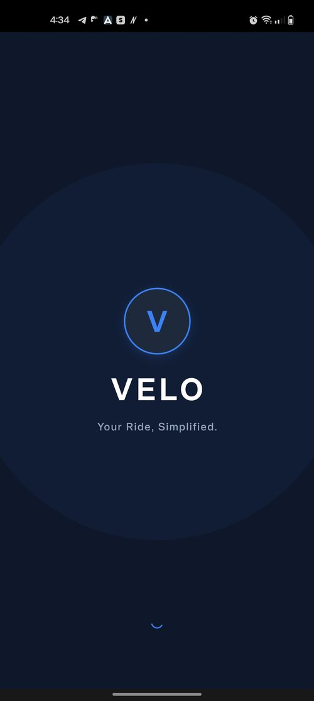
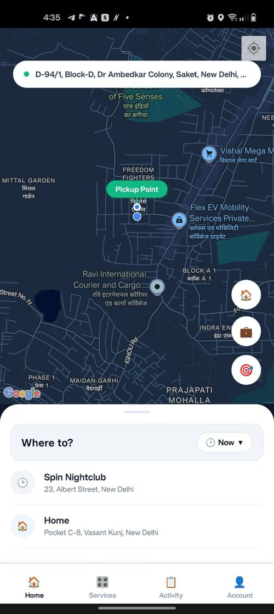
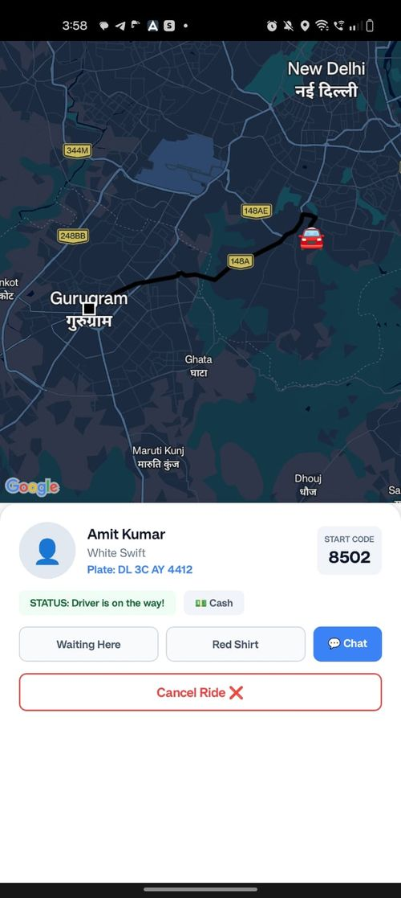
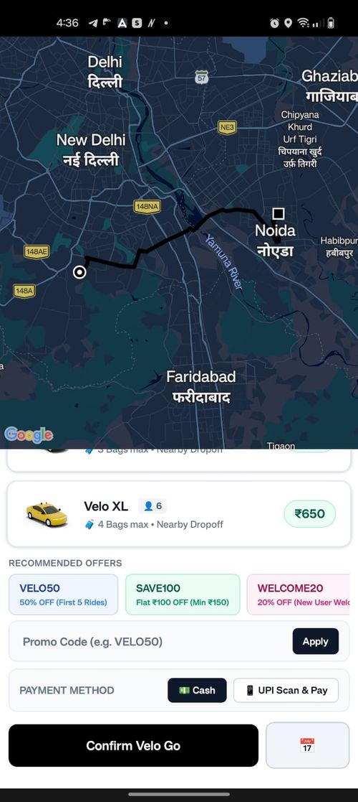
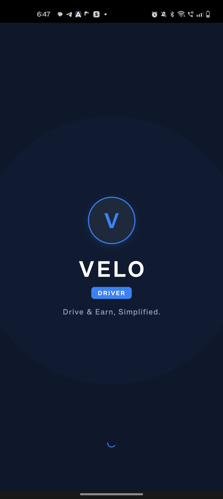
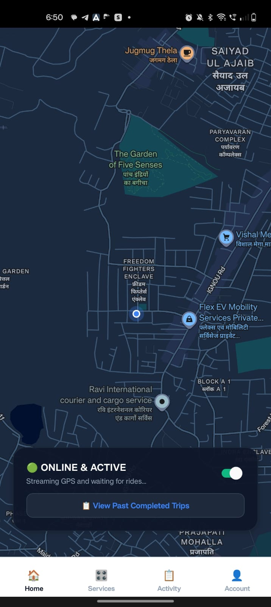
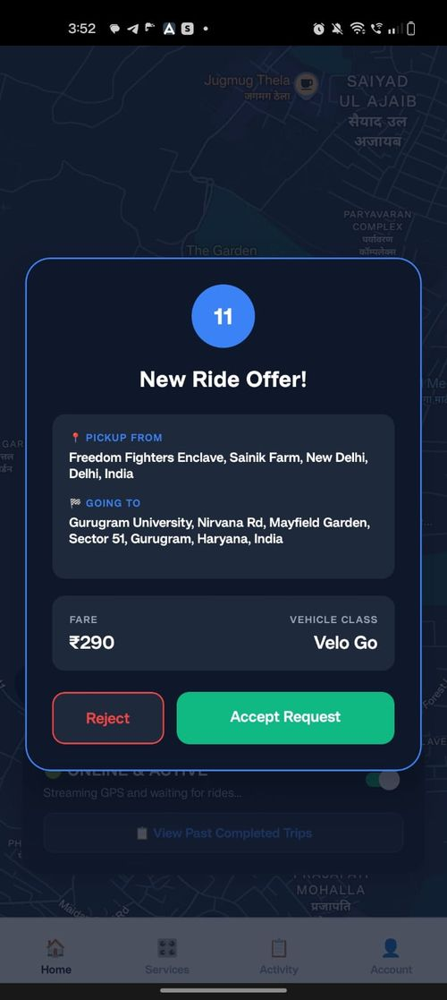
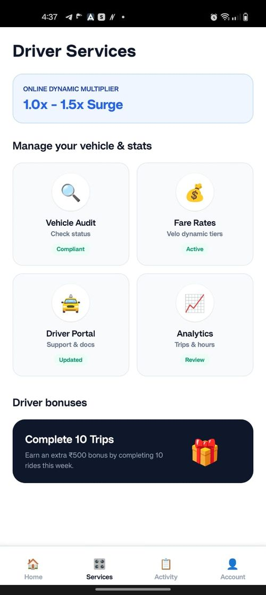
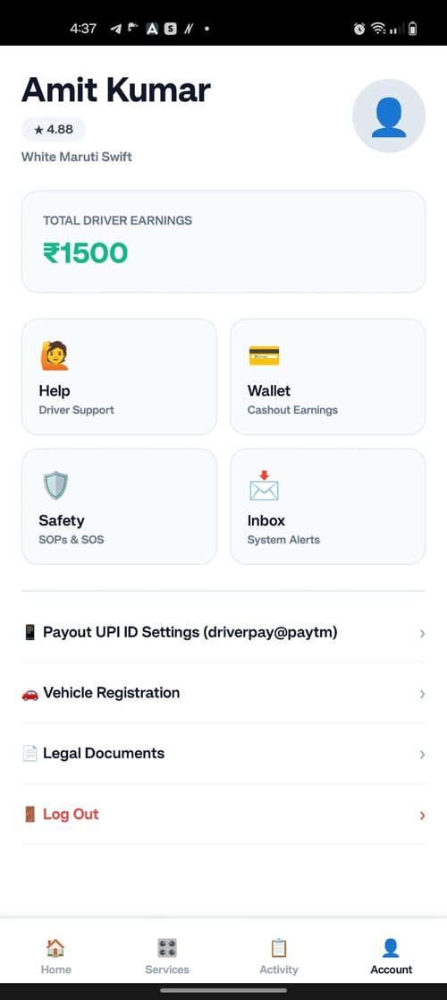

# Velo — Real-Time Ride Booking App

Velo is a full-stack ride-booking platform with separate **Passenger** and **Driver** apps, a real-time matching backend, and a dynamic fare engine. Built solo, end-to-end — mobile UI, backend APIs, real-time infrastructure, and cloud deployment.

> 🚧 Actively developed. This repo is a monorepo containing the backend, driver app, and passenger app.

---

## ✨ Features

- **Real-time ride matching** — Socket.IO broadcasts new ride requests to all online drivers simultaneously via shared rooms, with a 15-second accept/reject window per driver.
- **Dynamic fare engine** — Haversine-based distance calculation, multi-tier vehicle pricing, peak-hour and weather-based surge multipliers, and multi-stop route support.
- **Fraud-resistant promo codes** — discount/promo validation happens server-side to prevent client-side fare tampering.
- **OTP-verified rides** — ride start requires OTP confirmation between rider and driver.
- **Live ride status** — accepted → on-trip → completed/cancelled, synced in real time to both apps.
- **Driver ratings** — post-ride ratings with aggregate score recalculation.
- **Dual payments** — Cash and UPI Scan & Pay.
- **Live location & search** — Google Maps API for live tracking, Google Places API for autocomplete.

---

## 🏗️ Architecture

```
┌─────────────────┐        ┌──────────────────┐        ┌──────────────────┐
│   RideApp (RN)   │◄──────►│   Backend (Node)  │◄──────►│  DriverApp (RN)  │
│  Passenger app   │  REST  │  Express + Socket │  REST  │   Driver app     │
└─────────────────┘  + WS  │       .IO          │  + WS  └──────────────────┘
                            │   MongoDB (data)   │
                            └──────────────────┘
```

- **Backend**: Node.js + Express REST API, Socket.IO for real-time events, MongoDB for persistence, Firebase for authentication.
- **RideApp / DriverApp**: React Native (CLI), React Navigation, Axios for API calls, AsyncStorage for local session data.

---

## 📁 Repo Structure

```
RideBook/
├── Backend/        # Node.js + Express API, Socket.IO server, MongoDB models
├── DriverApp/      # React Native app for drivers
├── RideApp/        # React Native app for passengers
└── docs/           # Architecture notes, screenshots
```

Each app folder has its own README with setup-specific instructions.

---

## 🛠️ Tech Stack

| Layer | Tech |
|---|---|
| Mobile | React Native (CLI), React Navigation |
| Backend | Node.js, Express.js |
| Real-time | Socket.IO |
| Database | MongoDB |
| Auth | Firebase Authentication |
| Maps | Google Maps API, Google Places API |
| Deployment | Microsoft Azure (VM) |
| Media | Cloudinary |

---

## 🚀 Getting Started

### Prerequisites
- Node.js ≥ 18
- MongoDB (local or Atlas)
- Android Studio + emulator (or physical device)
- Firebase project (for auth keys)
- Google Maps / Places API key

### 1. Clone the repo
```bash
git clone https://github.com/SimranKausal/RideBook.git
cd RideBook
```

### 2. Backend setup
```bash
cd Backend
npm install
cp .env.example .env   # add your MongoDB URI, Firebase keys, etc.
npm run dev
```

### 3. Run the Passenger app
```bash
cd RideApp
npm install
npx react-native run-android
```

### 4. Run the Driver app
```bash
cd DriverApp
npm install
npx react-native run-android
```

---

## 📸 Screenshots

### Passenger App

<table>
<tr>
<td align="center" width="25%"><br/><sub><b>Splash screen</b></sub></td>
<td align="center" width="25%"><br/><sub><b>Home — live map & pickup point</b></sub></td>
<td align="center" width="25%"><br/><sub><b>Tracking assigned driver en route</b></sub></td>
<td align="center" width="25%"><br/><sub><b>Fare selection, promo codes & payment</b></sub></td>
</tr>
</table>

### Driver App

<table>
<tr>
<td align="center" width="20%"><br/><sub><b>Splash screen</b></sub></td>
<td align="center" width="20%"><br/><sub><b>Online & active, awaiting rides</b></sub></td>
<td align="center" width="20%"><br/><sub><b>Incoming ride request</b></sub></td>
<td align="center" width="20%"><br/><sub><b>Driver services & bonuses</b></sub></td>
<td align="center" width="20%"><br/><sub><b>Profile & earnings</b></sub></td>
</tr>
</table>

---

## 🗺️ Roadmap

- [ ] In-app chat between rider and driver
- [ ] Ride history and receipts
- [ ] Admin dashboard for monitoring rides

---

## 👤 Author

**Simran Kaushal**
[LinkedIn](https://linkedin.com/in/simran025) · [GitHub](https://github.com/SimranKausal)